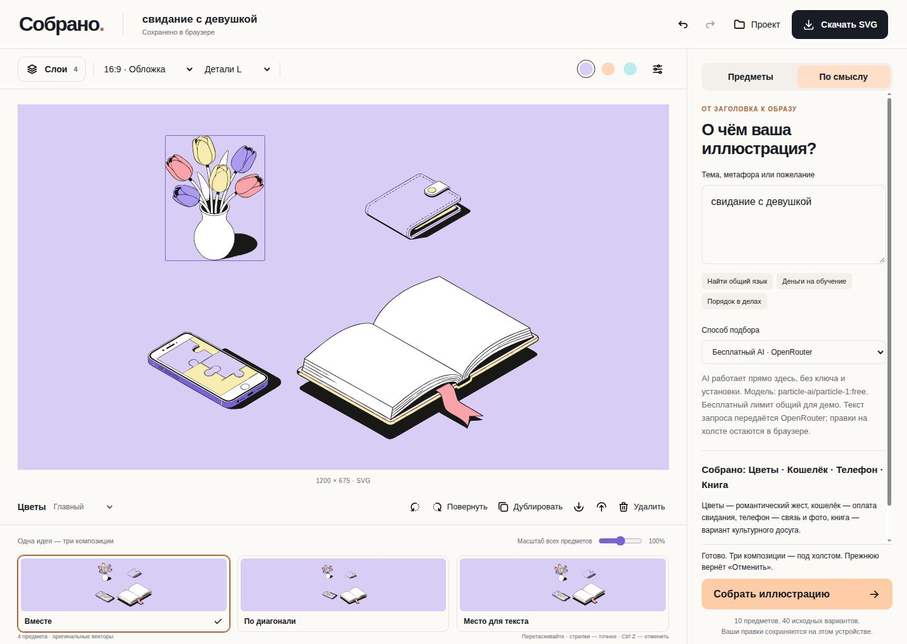

# Собрано · редактор иллюстраций

Тестовое Студии Очень: веб-сервис собирает композиции из **40 оригинальных вариантов** библиотеки. Выбор по предметам или по смыслу, три раскладки, редактирование целых объектов и векторный SVG. Собственный дизайн, бесплатный AI по ссылке и автономная CPU-модель для локального запуска. Посетителю не нужен API-ключ.

**[Открыть редактор с AI](https://vadimmukabenov.github.io/studia-ochen-plugin/)** · **[Готовый локальный комплект](https://github.com/VadimMukabenov/studia-ochen-plugin/releases/tag/v0.3.0)** · [Короткая демонстрация](docs/editor-demo.mp4)



**Откройте ссылку → «По смыслу» → введите тему → «Собрать иллюстрацию».** AI работает онлайн без установки и регистрации. Бесплатная модель — `particle-ai/particle-1:free` через OpenRouter; ключ хранится в Cloudflare Secret и не передаётся в браузер. Лимит запросов общий для демо. При исчерпании квоты редактор сохраняет работу и позволяет собрать композицию вручную.

Проверено на опубликованной странице 25 ноября: «свидание с девушкой» → одна кнопка → композиция и три раскладки → поворот → скачанный векторный SVG. Отмена восстанавливает прежнюю сцену. [Проверки текущей версии](docs/evidence/one-click-2026-11-25.json).

25 ноября также исправлены запуск при сетевом сбое и оформление полей: библиотека загружается одним сжатым файлом и кэшируется; рамка фокуса не обрезается. [Проверки и текущие ограничения](docs/verification.md), [вид полей](docs/editor-fields.png). Последний повторный AI-запрос получил ограничение бесплатного провайдера; ручной редактор и экспорт проверены.

## Проверить за две минуты

1. На холсте уже **телефон и пазлы**. Нажать три варианта под холстом: «Вместе», «По диагонали», «Место для текста».
2. Перетащить предмет, повернуть, дублировать, сменить роль «Главный/Фоновый» и порядок через кнопки или «Слои». Попробовать отмену и повтор. Стрелки — перемещение, Shift — шаг10, Ctrl/Cmd Z — отмена.
3. Переключить **настоящие исходные S/L**, формат и одну из трёх палитр. В настройках палитры скачать образец JSON, изменить цвета и загрузить его обратно. Фон может быть прозрачным.
4. **По смыслу** → ввести тему → **«Собрать иллюстрацию»**. Предметы и три раскладки появятся сразу, без второго подтверждения. Попробовать «Сохранить деньги на будущую учёбу» и «Книга и кошелёк без телефона». Кнопка «Отменить» возвращает прежнюю композицию. При слабом соответствии локальной модели сначала показывается предупреждение и выбор предметов.
5. **Скачать SVG**. Внутри исходные контуры, отдельные группы предметов и metadata. Открывается в Figma, Illustrator и Inkscape. В «Проекте» также доступны PNG и переносимый JSON. Перезагрузка восстанавливает работу в том же браузере.

В самом приложении: «Проект» → «Как проверить за 2 минуты», там же три готовых примера.

## Необязательно: автономный запуск на своём компьютере

Готовые комплекты v0.3.0 соответствуют автономному выпуску 22 ноября. Текущий веб-редактор и исходники обновлены 25 ноября: обычный смысловой подбор сразу собирает композицию.

Нужен только **запущенный Docker Desktop** (Linux: Docker Engine + Compose v2). Figma, Git, Node, Python, API-ключ и GPU не нужны. Рекомендуется 4 ГБ свободной RAM и 4 ГБ диска для архива и образа.

1. Скачать и полностью распаковать ZIP: **[Windows / Linux x64 / Intel Mac](https://github.com/VadimMukabenov/studia-ochen-plugin/releases/download/v0.3.0/sobrano-amd64.zip)** или **[Apple Silicon / Linux ARM64](https://github.com/VadimMukabenov/studia-ochen-plugin/releases/download/v0.3.0/sobrano-arm64.zip)**.
2. Windows: дважды щёлкнуть `START.cmd`. macOS/Linux: в распакованной папке выполнить одну команду:

   ```sh
   sh START.command
   ```

3. Откроется **http://127.0.0.1:18763**. Модель уже в образе: после скачивания ZIP запуск и работа не требуют интернета.

Повторный запуск: `docker compose up -d --wait`. Остановка: `STOP.cmd`, `sh STOP.command` или `docker compose down`. Порт 18763 должен быть свободен. При ошибке: `docker compose logs`. Установка Docker и скачивание архива не входят в время запуска приложения. Windows ARM и Windows containers не проверены; Docker Desktop должен использовать Linux containers. Нативные launchers на Windows/macOS не запускались на этих ОС; обе Linux CPU-архитектуры проверяются отдельно.

## Что сделано

| Возможность | Реализация |
|---|---|
| Библиотека | 10 предметов × S/L × главный/фоновый = 40 оригиналов, без новых рисунков |
| Сборка | Явные названия или выбор в библиотеке; три различные раскладки; четыре формата |
| Редактор | Перемещение, поворот, дублирование, удаление, порядок, роль, общий масштаб |
| Цвет | Три исходные палитры, импорт JSON, устойчивые семантические роли при повторной перекраске |
| Сохранение | Отмена/повтор, восстановление в браузере, проверяемый JSON проекта |
| Экспорт | Редактируемый SVG с исходными путями; дополнительно PNG |
| AI | Онлайн OpenRouter через Cloudflare Worker; автономный ONNX CPU retrieval в локальном комплекте |
| Доставка | Публичные исходники, веб-демо, готовые amd64/arm64 ZIP с моделью и Docker Compose |

Размеры предметов связаны **одним общим масштабом**. Отдельно растягивать предметы нельзя: так сохраняются пропорции исходной библиотеки. Импорт проекта принимает данные сцены, а не произвольный SVG. Недопустимый JSON не удаляет текущую композицию.

## Три примера из приложения

[Время учиться](examples/1-learning.svg) · [Связь складывается](examples/2-connection.svg) · [Финансовая опора](examples/3-savings.svg).

Эти SVG скачаны кнопкой конечного редактора. Контуры: 105 / 212 / 244; растровых изображений нет. [Демонстрация](docs/editor-demo.mp4) — последовательность реальных состояний редактора, не нарисованный макет.

## Как работает смысловой режим

Запрос сначала проходит ограничения: явно названные предметы сохраняются, поддерживаемые исключения удаляются. Фразы вроде «без телефона, но с книгой» разбираются до модели. Сложные отрицания могут потребовать уточнения; это не универсальный язык команд.

Локальная **intfloat/multilingual-e5-small** переводит тему, описания предметов и смысловые примеры сочетаний в embedding. Cosine similarity выбирает существующие ID; низкое сходство отклоняется, слабое/близкое соответствие помечается. Это **retrieval, не LLM**. Модель не рисует и не меняет исходники. При обычном успешном ответе композиция собирается сразу. Если локальная модель явно помечает соответствие как слабое, пользователь сначала проверяет предложение или уточняет запрос. Ошибка/поздний ответ не заменяет ручные правки. Отдельный «Подбор по темам» — обычный словарь, явно обозначенный как алгоритм без AI.

Предварительно записанный набор: **17/18** принятых ожиданий; «Что-то красивое» предлагает цветы, хотя ожидалось уточнение. Сходство не является вероятностью; небольшой набор не доказывает понимание любых метафор. [Входы и результаты](docs/evidence/semantic-holdout.json), [первый прогон](docs/evidence/semantic-holdout-results.json), [после исправления независимой регрессии](docs/evidence/semantic-after-regression-fix.json).

В опубликованном редакторе бесплатный OpenRouter уже подключён через сервер. На 24.11.2026 бесплатного DeepSeek в каталоге нет; используется Particle. Общая квота ограничена, текущий ключ действует до 22.12.2026. [Устройство сервера и ограничения](online/README.md).

Для собственного локального OpenRouter: создать бесплатный ключ, скопировать `.env.example` в `.env`, указать ключ и перезапустить Compose. Используются только `:free` / `openrouter/free` и ограничение цены провайдера0. **Ключ автора не включён**. Бесплатные модели могут менять качество и выдавать429; платного переключения и автоматических покупок нет. Для проверки задания этот режим не нужен. [Проверка бесплатного API](docs/free-cloud-spike.md).

## Архитектура и исходники

- `web/core.mjs`: проверка сцены/палитры, раскладки, операции с целыми предметами и SVG-сериализация.
- `web/app.mjs`, `index.html`, `styles.css`: браузерный интерфейс, история, localStorage, импорт/экспорт, автоматическая сборка по смыслу с отменой и защитой ручных правок. Без frontend-фреймворка и обязательного CDN.
- `web/assets/`, `catalog.mjs`: все40 оригинальных SVG и каталог. `source/originals/`, `extraction.json`, `scripts/extract-library.py`: воспроизводимое извлечение, SHA исходников, сохранение всех path d. [Происхождение](source/README.md).
- `helper/server.py`, `planner.py`: один локальный HTTP-сервис, CPU inference, ограничения/allowlist, необязательный серверный OpenRouter. Ключи не возвращаются клиенту; запросы не журналируются. Порт опубликован только на loopback.
- `online/worker/index.js`: публичные `/health` и `/resolve` на Cloudflare Workers, проверка контракта и каталога, бесплатная модель и серверный Secret. Статический frontend остаётся на GitHub Pages.
- `Dockerfile`, `compose.yaml`, `installer/`: непривилегированный runtime, healthcheck; source-сборка кэширует модель в volume, готовый reviewer-образ содержит модель внутри.
- `code.ts`, `ui.html`, `manifest.json`: дополнительный первоначальный Figma-плагин. Его нативный запуск в Figma Desktop не подтверждён; **основной законченный результат — веб-сервис**, допустимый заданием. `prototype/` — исторический черновик, не точка запуска.

Модель [intfloat/multilingual-e5-small](https://huggingface.co/intfloat/multilingual-e5-small), MIT, revision `614241f622f53c4eeff9890bdc4f31cfecc418b3`. SHA256 весов и tokenizer проверяются; model card включена в образ. Иллюстрации — материалы авторов задания, использованы только для этого решения. Иконки Tabler, MIT, лицензия в `web/icons/LICENSE`. Код/дизайн конкурента не копировались.

## Запуск из исходников и проверки

```sh
git clone https://github.com/VadimMukabenov/studia-ochen-plugin.git
cd studia-ochen-plugin
docker compose up --build -d --wait
```

В отличие от готового ZIP, первый source-запуск скачивает зависимости и около488МБ модели; нужны интернет и время сборки. Модель остаётся в volume. `docker compose down -v` удалит её кэш.

Разработка: `npm ci`, затем `npm test && npm run test:online && npm run check && npm run build`. Экспорт source ZIP: `npm run package`. Проверка извлечения: `python3 tests/test_library.py`. После запуска сервиса: `npm run test:live` (реальные HTTP/model/SVG проверки; нужен Python). Python unit suites требуют зависимости из `helper/requirements.txt`. `npm run test:ui` относится к дополнительной панели плагина; основной веб-редактор проверялся отдельно в браузере. [Приёмка по трём критериям](docs/acceptance.md), [подробная проверка и ограничения](docs/verification.md), [дизайн QA](design-qa.md), [сравнение функций](docs/comparison.md).

AI-инструменты разработки: Codex — реализация, тесты, документация и ревью; локальный Figma MCP — аккаунт, структура, геометрия и цвета исходной библиотеки; ImageGen — три варианта **интерфейса** для выбора собственного дизайна. Иллюстрации из ImageGen в результат не добавлялись. Во время работы приложения — локальная embedding-модель либо явно выбранный бесплатный OpenRouter.
